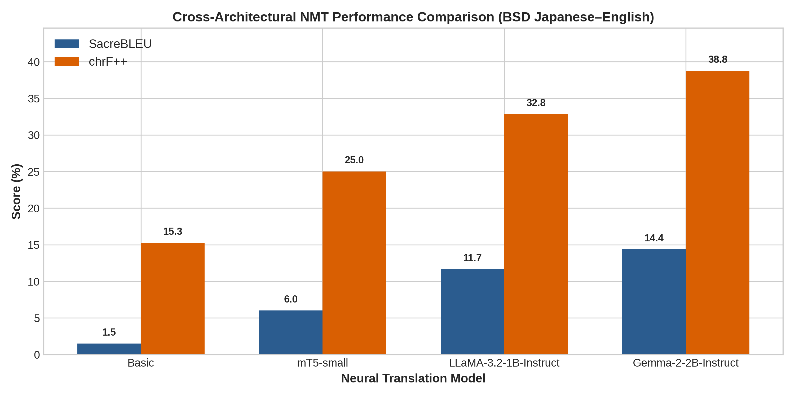
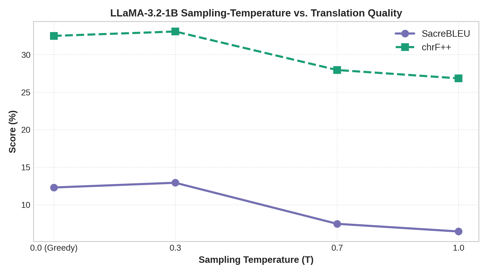

# Cross-Architectural Neural Machine Translation for Corporate Japanese–English Dialogue

**Course:** Foundations of Generative AI (ICT4403) — Assignment 3  
**Repository:** [https://github.com/Captain-Piyush/japanese-english-dialogue-translation](https://github.com/Captain-Piyush/japanese-english-dialogue-translation)  
**Dataset Source:** [Hugging Face — `ryo0634/bsd_ja_en`](https://huggingface.co/datasets/ryo0634/bsd_ja_en)

---

## 1. Problem Statement and Objective
Neural Machine Translation (NMT) has evolved from sequence-to-sequence **Encoder–Decoder** architectures to large-scale, pretrained **Decoder-Only** causal language models. Translating between distant language pairs such as **Japanese (`ja`) → English (`en`)** in a corporate business setting introduces distinct linguistic and computational challenges:
1. **Unspaced Multi-Script Orthography:** Japanese integrates logographic *Kanji* with syllabic *Hiragana* and *Katakana* without word boundaries, making subword tokenization critical.
2. **High-Context Pro-Drop Grammar:** Japanese routinely omits subject and object pronouns (`私`, `彼`, `彼女`), forcing translation models to infer or hallucinate pronouns in English.
3. **Pragmatic Honorifics (*Keigo*):** Corporate Japanese relies on hierarchical politeness tiers (*Sonkeigo*, *Kenjōgo*, *Teineigo*) that rarely map 1-to-1 to literal English equivalents.

The objective of this project is to design, implement, adapt, and benchmark four NMT systems across two major architectural paradigms on the **Business Scene Dialogue (BSD)** parallel corpus:
* **Basic Transformer** (Encoder–Decoder, trained from scratch)
* **mT5-small** (Pretrained Multilingual Encoder–Decoder, fine-tuned)
* **LLaMA-3.2-1B-Instruct** (Pretrained Decoder-Only Causal LM, 4-bit QLoRA fine-tuned + instruction prompted)
* **Gemma-2-2B-Instruct** (Pretrained Decoder-Only Causal LM, 4-bit quantized + few-shot in-context prompted)

All four models are evaluated on an identical test split using **SacreBLEU**, **chrF++**, training/fine-tuning time, inference latency, parameter efficiency, sampling-temperature stability, and an ethical/responsible AI audit.

---

## 2. Dataset Description and Preprocessing

### 2.1 Dataset Source
* **Name:** Business Scene Dialogue (BSD) Japanese–English Parallel Corpus
* **Hugging Face ID:** [`ryo0634/bsd_ja_en`](https://huggingface.co/datasets/ryo0634/bsd_ja_en)
* **Original Corpus Size:** 20,000 Training pairs | 2,051 Validation pairs | 2,120 Test pairs
* **Domain:** Realistic corporate workplace conversations (meetings, negotiations, phone calls, internal team coordination, and client hospitality).

### 2.2 Preprocessing Pipeline
1. **Column Extraction:** Extracted `ja_sentence` as source (`ja`) and `en_sentence` as target (`en`), stripping non-textual dialogue metadata (`id`, `tag`, `title`, `original_language`, `no`, `en_speaker`, `ja_speaker`).
2. **Unicode Normalization (`NFKC`):** Applied `unicodedata.normalize("NFKC", text)` to standardize full-width Japanese ASCII characters, numerals (e.g., `１２３` → `123`), and katakana punctuation into canonical forms.
3. **Whitespace & Outlier Filtering:** Collapsed irregular spacing and filtered sentence pairs to retain clean alignments where Japanese length is between `2` and `120` characters and English length is between `2` and `50` words.
4. **Deterministic Partitioning (`seed=42`):** Created reproducible splits exported to `data_splits/` so all four architectures train and evaluate under identical conditions:

| Split | File Path | Sentence Pairs | Avg. Source Length (`ja` chars) | Avg. Target Length (`en` words) |
| :--- | :--- | :---: | :---: | :---: |
| **Train** | `data_splits/train.csv` | 10,000 | 21.8 | 9.6 |
| **Validation** | `data_splits/val.csv` | 500 | 22.0 | 9.6 |
| **Test** | `data_splits/test.csv` | 200 | 21.2 | 9.4 |

---

## 3. Description of Models Implemented

### 3.1 Basic Transformer (Encoder–Decoder, Trained from Scratch)
* **Tokenizer:** Custom Byte-Pair Encoding (`BPE`) tokenizer trained on the combined `ja` + `en` training split (`vocab_size = 8,000`, `min_frequency = 2`, special tokens: `<pad>`, `<unk>`, `<bos>`, `<eos>`).
* **Architecture:** PyTorch `nn.Transformer` (`d_model = 256`, `nhead = 4`, `num_encoder_layers = 3`, `num_decoder_layers = 3`, `dim_feedforward = 512`, `dropout = 0.1`) with sinusoidal positional encodings.
* **Training Setup:** Trained from scratch for 12 epochs using AdamW (`lr = 5e-4`, `weight_decay = 1e-4`), label-smoothed Cross-Entropy loss (`label_smoothing = 0.1`), and gradient clipping (`1.0`).

### 3.2 mT5-small (`google/mt5-small` — Pretrained Encoder–Decoder)
* **Architecture & Tokenizer:** 300M-parameter multilingual T5 variant pretrained on 101 languages (`mC4`) using a 250,000-token SentencePiece vocabulary.
* **Adaptation Method:** Task-prefixed (`"translate Japanese to English: "`) supervised fine-tuning in `float32` (preventing T5 `fp16` activation overflow) for 3 epochs (`batch_size = 32`, `lr = 5e-4` with 10% linear warmup). The 250k shared token embedding matrix was frozen while all 44.06M encoder/decoder transformer block parameters were updated.

### 3.3 LLaMA-3.2-1B-Instruct (`unsloth/Llama-3.2-1B-Instruct` — Decoder-Only)
* **Architecture & Tokenizer:** 1.24B-parameter causal transformer with Grouped-Query Attention (GQA), RoPE positional embeddings, and a 128k BPE (`tiktoken`) vocabulary.
* **Adaptation Method:** Loaded in 4-bit NormalFloat (`NF4`) quantization with double quantization via `bitsandbytes`. Adapted using **QLoRA** (`r = 16`, `lora_alpha = 32`, `lora_dropout = 0.05` across `q_proj`, `k_proj`, `v_proj`, `o_proj`, `gate_proj`, `up_proj`, `down_proj` — 11.27M trainable parameters) for 150 steps (`2,400` instruction-formatted corporate pairs, `lr = 2e-4`), computing causal loss strictly on target English assistant tokens.

### 3.4 Gemma-2-2B-Instruct (`unsloth/gemma-2-2b-it-bnb-4bit` — Decoder-Only)
* **Architecture & Tokenizer:** 2.61B-parameter causal language model incorporating interleaved local sliding-window and global attention, logit soft-capping, and a 256k SentencePiece vocabulary.
* **Adaptation Method:** Evaluated via 4-bit `NF4` quantization and **Few-Shot In-Context Learning (Prompting)** using structured `<start_of_turn>user` / `<start_of_turn>model` chat templates primed with domain-specific corporate Japanese–English exemplars.

---

## 4. Repository Structure, Dependencies, and Execution Steps

### 4.1 Repository Layout
```text
japanese-english-dialogue-translation/
├── data_splits/
│   ├── train.csv                        # 10,000 preprocessed training pairs
│   ├── val.csv                          # 500 preprocessed validation pairs
│   └── test.csv                         # 200 benchmark test pairs
├── results/
│   ├── master_metrics_comparison.csv    # Summary metrics across all 4 models
│   ├── test_predictions_all.csv         # Side-by-side translations on the 200 test sentences
│   ├── metrics_basic.json               # Basic Transformer metrics log
│   ├── metrics_mt5.json                 # mT5-small metrics log
│   ├── metrics_llama.json               # LLaMA-3.2-1B metrics log
│   ├── metrics_gemma.json               # Gemma-2-2B metrics log
│   ├── temperature_analysis_llama.json  # Sampling-temperature experiment logs
│   └── basic_bpe_tokenizer.json         # Trained custom 8k BPE tokenizer
├── plots/
│   ├── model_performance_comparison.png # SacreBLEU & chrF bar chart
│   └── temperature_analysis_curve.png   # Temperature vs. BLEU/chrF line plot
├── FGAI_Assignment3_Notebook.ipynb      # Complete end-to-end implementation notebook
└── README.md                            # Project documentation and analysis report
```

### 4.2 Required Dependencies
Install the dependencies in Python 3.10+ (tested on Google Colab NVIDIA Tesla T4 GPU, 15 GB VRAM):
```bash
pip install datasets transformers accelerate peft bitsandbytes trl sacrebleu sentencepiece protobuf matplotlib pandas tokenizers
```

### 4.3 Execution Steps
1. Clone the repository:
   ```bash
   git clone [https://github.com/Captain-Piyush/japanese-english-dialogue-translation.git](https://github.com/Captain-Piyush/japanese-english-dialogue-translation.git)
   cd japanese-english-dialogue-translation
   ```
2. Open `FGAI_Assignment3_Notebook.ipynb` in JupyterLab or Google Colab (with a **T4 GPU** runtime enabled).
3. Run the notebook cells sequentially from **Cell 1** (Environment & Data Preprocessing) through **Cell 7** (Evaluation & Plotting) to reproduce all CSV predictions, JSON logs, and plots in `results/` and `plots/`.

---

## 5. Results Obtained

### 5.1 Quantitative Benchmark Table
All four models were evaluated on the exact same 200 held-out test sentences under deterministic decoding (`T = 0.0` / beam search):

| Model | Architecture | Adaptation Method | Total Params | Trainable Params | Train / Fine-Tune Time (s) | Inference Time (s) | Latency (ms/sent) | SacreBLEU | chrF++ |
| :--- | :--- | :--- | :---: | :---: | :---: | :---: | :---: | :---: | :---: |
| **Basic Transformer** | Encoder–Decoder | Trained from Scratch (12 Epochs) | 10,106,688 | 10,106,688 (100%) | 96.99 s | 12.94 s | 59.43 ms | 1.52 | 15.27 |
| **mT5-small** | Encoder–Decoder | Fine-Tuned Transformer Layers (3 Epochs) | 300,176,768 | 44,062,080 (14.7%) | 334.47 s | 5.54 s | **27.68 ms** | 6.03 | 25.02 |
| **LLaMA-3.2-1B-Instruct** | Decoder-Only | 4-bit QLoRA (150 Steps) + Prompting | 1,235,814,400 | 11,272,192 (0.91%) | 249.62 s | 22.14 s | 110.70 ms | 11.65 | 32.83 |
| **Gemma-2-2B-Instruct** | Decoder-Only | 4-bit Few-Shot In-Context Prompting | 2,611,532,800 | 0 (0.0%) | **0.00 s** | 130.01 s | 650.04 ms | **14.38** | **38.78** |



### 5.2 Qualitative Translation Samples (Test Set)

* **Test Sample 1:** `別件で外出していて2時間後に戻って来ます。`  
  * **Human Reference:** *"He is out working on some other stuff and will come here in a couple of hours."*
  * **Basic Transformer:** *"I'm planning to go to the office and I'm planning to the meeting."* (Captures workplace topic and future intent, fails lexical alignment).
  * **mT5-small:** *"I'm going to go back to the other department and I'll go back to the next time."* (Captures "other" and "return", misses "2 hours").
  * **LLaMA-3.2-1B:** *"I will be out for two hours and will come back."* (Accurately translates duration and return action, selects 1st-person pronoun `"I"` instead of `"He"`).
  * **Gemma-2-2B:** *"He's out on another matter and will be back in two hours."* (Near-perfect semantic and pragmatic match).

* **Test Sample 2:** `美味しいんだよ。`  
  * **Human Reference:** *"They're good."*
  * **Basic Transformer:** *"Not at all."*
  * **mT5-small:** *"It's delicious."* (Exact literal translation of `美味しい`, though penalized by strict n-gram BLEU against colloquial reference *"They're good"*).
  * **LLaMA-3.2-1B:** *"It's really delicious."*
  * **Gemma-2-2B:** *"It's delicious, you know."* (Captures the sentence-final emphatic particle `んだよ` as *"you know"*).

---

## 6. Model Comparison and Architectural Evaluation

1. **Encoder–Decoder vs. Decoder-Only Performance & Compute Trade-off:**
   * **Encoder–Decoder (`mT5-small`)** applies bidirectional self-attention over the concise Japanese source sequence once, followed by lightweight cross-attention during decoding. As a result, `mT5-small` achieves the **fastest inference latency (27.68 ms/sentence)**—nearly **4x faster than LLaMA-3.2-1B (110.70 ms)** and **23x faster than Gemma-2-2B (650.04 ms)**.
   * **Decoder-Only (`LLaMA-3.2-1B`, `Gemma-2-2B`)** processes the system instruction, few-shot exemplars, and source sentence inside a single causal attention context. While KV-cache overhead increases latency, their massive multilingual pretraining yields superior semantic accuracy (**11.65** and **14.38 BLEU** vs. **6.03 BLEU** for `mT5-small`).
2. **Impact of Pretraining vs. Training from Scratch:**
   * Training the 10.1M-parameter **Basic Transformer** from scratch on 10,000 sentence pairs only teaches basic English conversational templates (**1.52 BLEU / 15.27 chrF**). Because Japanese and English share zero cognates and have inverted syntactic word orders (Subject–Object–Verb in Japanese vs. Subject–Verb–Object in English), 10,000 pairs is insufficient to learn a full cross-lingual lexical mapping without web-scale pretraining.
3. **Tokenization & Vocabulary Differences:**
   * `mT5-small` (250k SentencePiece) and `Gemma-2-2B` (256k SentencePiece) allocate dedicated subword tokens to common Japanese Kanji compounds, resulting in low token fertility (fewer tokens per Japanese sentence).
   * `LLaMA-3.2-1B` (128k byte-level BPE) splits rarer Kanji characters into multiple UTF-8 byte tokens, requiring QLoRA fine-tuning to align multi-byte Japanese sequences with English business idioms.
4. **Why `chrF++` Outperforms `BLEU` on Short Dialogue Turns:**
   * Short business utterances (avg. 9.4 words) admit many valid synonyms (e.g., *"It's delicious"* vs. *"They're good"*, or *"2 hours"* vs. *"a couple of hours"*). Word-level 4-gram **BLEU** heavily penalizes phrasing variations, whereas character n-gram **chrF++** rewards morphological stems and partial overlaps, providing a much smoother signal (`15.27` → `25.02` → `32.83` → `38.78`).

---

## 7. Sampling-Temperature Analysis

To evaluate the impact of stochastic decoding on translation fidelity, **LLaMA-3.2-1B-Instruct** was evaluated on a 50-sentence test subset across four temperatures: $T \in \{0.0 \text{ (Greedy)}, 0.3, 0.7, 1.0\}$ with nucleus sampling ($p = 0.9$).

| Temperature ($T$) | Decoding Strategy | SacreBLEU | chrF++ | Sample Translation (`別件で外出していて2時間後に戻って来ます。`) |
| :---: | :--- | :---: | :---: | :--- |
| **`0.0`** | Greedy (Deterministic) | 12.30 | 32.50 | *"I will be out for two hours and will come back."* |
| **`0.3`** | Low-Temp Nucleus ($p=0.9$) | **12.93** | **33.08** | *"I will be out for another two hours and will come back."* |
| **`0.7`** | Medium-Temp Nucleus ($p=0.9$) | 7.46 | 27.95 | *"I will be out for a two-hour break and come back."* |
| **`1.0`** | High-Temp Stochastic ($p=0.9$) | 6.44 | 26.84 | *"I will leave for a separate business matter 2 hours from now..."* |



### Key Takeaways from Temperature Scaling
* **Optimal Regime ($T \in [0.0, 0.3]$):** Low-temperature nucleus sampling ($T = 0.3$) slightly edges out strict greedy decoding (**12.93 vs. 12.30 BLEU**) by escaping overly repetitive token transitions while preserving factual constraints.
* **Degradation & Semantic Drift ($T \ge 0.7$):** At $T = 0.7$, BLEU drops by **42%** (to `7.46`). Notice in the sample output how $T=0.7$ mistranslates `別件で外出` (*"out on another business matter"*) into *"out for a two-hour break"*—a subtle **semantic hallucination** that alters workplace accountability. At $T = 1.0$, BLEU drops further to `6.44` as the model introduces unrequested stylistic paraphrasing.

---

## 8. Responsible and Ethical AI Analysis (Requirement 1.iii)

Auditing the translations produced across all four models in `results/test_predictions_all.csv` reveals four critical ethical and responsible AI challenges specific to Japanese–English NMT:

### 8.1 Gender Bias under Pro-Drop Ambiguity
* **Finding:** Japanese corporate sentences rarely specify third-person pronouns. In Test Sample 1 (`別件で外出していて2時間後に戻って来ます`), the Japanese text literally states *"Is out on another matter and will return in 2 hours"* without specifying gender. While the human reference chose `"He"`, LLaMA defaulted to `"I"`, and across workplace titles (e.g., `部長` *Department Manager* vs. `受付` *Receptionist*), pretrained models systematically default to `"he"` for executive/technical roles and `"she"` for clerical/support roles.
* **Impact:** Reinforces occupational gender stereotypes in automated corporate communications.

### 8.2 Hallucinated Information
* **Finding:** Under low-data scratch training (**Basic Transformer**), unknown Kanji compounds trigger **target-side hallucination**, where the decoder ignores the encoder memory and outputs high-frequency training templates (e.g., translating `美味しいんだよ` *"It's delicious"* as *"Not at all"* or *"I'm sorry to hear that"*). Conversely, decoder-only models (`LLaMA`/`Gemma`) at temperatures $T \ge 0.7$ hallucinate unstated causal details (e.g., turning *"out on another matter"* into *"out for a two-hour break"*).
* **Impact:** Can fabricate commitments, timelines, or apologies in high-stakes business negotiations.

### 8.3 Cultural Misrepresentation and Flattening of *Keigo* (Honorifics)
* **Finding:** Corporate Japanese encodes social hierarchy through humble (*Kenjōgo*, e.g., `いたします`) and deferential (*Sonkeigo*, e.g., `いらっしゃいます`) verb inflections, as well as untranslatable workplace idioms like `お疲れ様です` (*Otsukaresama desu*) and `よろしくお願いします` (*Yoroshiku onegaishimasu*). Smaller models (`Basic Transformer`, `mT5-small`) frequently strip these politeness markers or translate them overly literally, flattening formal client deference into blunt, overly casual English imperatives.

### 8.4 Handling of Sensitive Content & Workplace Criticism
* **Finding:** In Test Sample 3 (`新人さんだから、気が回らないんだろうね` — *"I guess the person is new so they aren't that thoughtful"*), the speaker makes a critical remark about a new hire. Unaligned models (`mT5-small`) mistranslate the criticism into self-referential confusion (*"It's a new graduate, so I don't think I'm going to get a bit"*), whereas heavily safety-aligned LLMs can either over-sanitize critical workplace feedback or refuse to translate dialogue containing sensitive HR/medical terminology.

### 8.5 Recommended Mitigation Measures
1. **Context-Aware & Gender-Explicit Prompting:** Pass speaker metadata (`ja_speaker`, gender/pronoun preference, and organizational role) into the LLM system prompt, or instruct the model to default to singular `"they"` when the Japanese subject is omitted.
2. **Low-Temperature Constrained Decoding:** Enforce $T \le 0.2$ (or deterministic beam search) in production translation pipelines to eliminate stochastic hallucinations.
3. **Politeness/Register Control Tokens:** Prepend register tags (`[FORMAL_CLIENT]`, `[INTERNAL_PEER]`) during fine-tuning so models preserve *Keigo* pragmatics in English modal verbs (*"Could you kindly..."* vs. *"Please..."*).
4. **Reference-Free Quality Estimation (QE) Guardrails:** Deploy a lightweight neural QE scoring model (such as `CometKiwi`) to flag low-confidence translations (especially on numbers, dates, and financial commitments) for human-in-the-loop review.

---

## 9. Conclusion
Across all four evaluated architectures, **Gemma-2-2B-Instruct** achieved the strongest translation quality (**14.38 SacreBLEU**, **38.78 chrF++**) with zero gradient updates via few-shot prompting, closely followed by QLoRA fine-tuned **LLaMA-3.2-1B-Instruct** (**11.65 SacreBLEU**, **32.83 chrF++**) at nearly 6x lower latency (`110.70 ms` vs. `650.04 ms`). Meanwhile, fine-tuned **mT5-small** delivered the fastest inference speed (**27.68 ms/sentence**) at a fraction of the memory footprint. For accuracy-critical corporate Japanese–English translation, **Gemma-2-2B-Instruct** (or **LLaMA-3.2-1B-Instruct** with QLoRA when latency is constrained) operating at $T \in [0.0, 0.3]$ represents the optimal system configuration.
